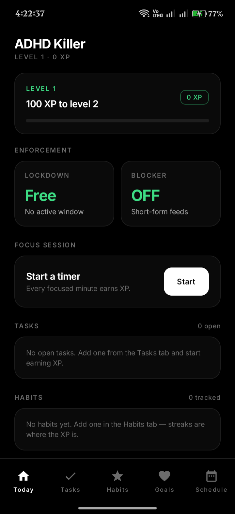
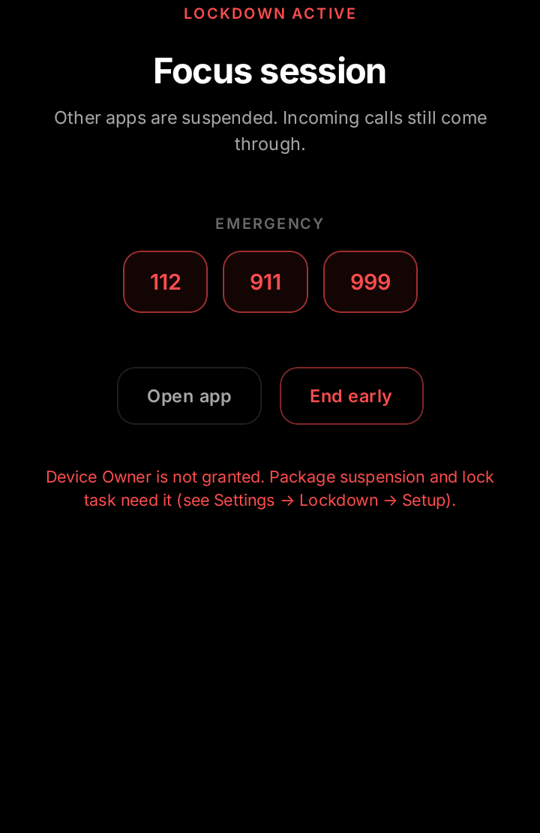
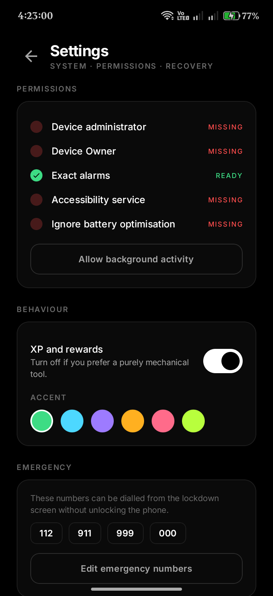
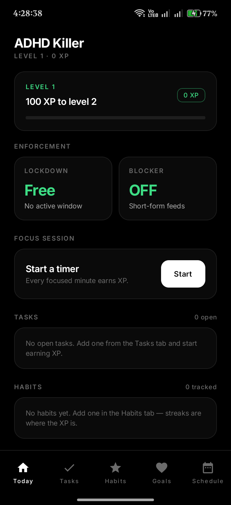

# ADHD Killer

**A focus and self-discipline app for Android.**

ADHD Killer combines task and habit management with tools designed to reduce digital distractions: scheduled phone lockdowns and a short-form video blocker.

> **Development status:** Active development. Core productivity features and enforcement flows are implemented, but some enforcement scenarios still need additional real-device verification.

## Screenshots

| Today | Lockdown |
|---|---|
|  |  |

| Settings | Dashboard |
|---|---|
|  |  |

## Features

### Focus and distraction control
- Scheduled phone lockdowns with recurring days and time windows.
- App allowlist to keep essential apps accessible.
- Short-form video blocking for YouTube Shorts, Instagram Reels, TikTok, Snapchat and Facebook Reels.
- Activity-aware YouTube blocking designed to preserve regular long-form videos.
- Optional AccessibilityService guard.
- Optional guardian launcher and Android screen pinning.
- Optional device administrator for uninstall protection.
- Reboot-aware lockdown scheduling.
- Emergency-call access during lockdown.

**Platform limitation:** Android does not provide ordinary apps with a universal API to prevent another app from launching. The accessibility guard detects a blocked screen, covers it and navigates away, so a blocked app may appear briefly. Some feed detection rules are heuristic and may change when the target apps are updated.

### Productivity
- **Tasks:** Priorities, due dates, estimated duration, tags and notes.
- **Habits:** Daily and weekly schedules, streaks and daily logs.
- **Goals:** Track targets, progress and deadlines.
- **Schedule:** Organize time blocks by weekday.
- **Focus sessions:** Built-in focus timer and session history.
- **Statistics:** Focus time, completed tasks, blocked feeds and XP.
- **Gamification:** XP, levels, streaks and unlockable rewards.

## Tech Stack

- Kotlin
- Jetpack Compose and Material 3
- Room / SQLite
- DataStore
- Navigation Compose
- AlarmManager and WorkManager
- AccessibilityService and Android platform APIs
- Gradle Kotlin DSL and KSP

## Requirements

- Android 8.0 (API 26) or newer.
- Android Studio with Android SDK Platform 37.
- JDK 21 for the project build toolchain.

The project currently targets Android 17 (API 37). Some capabilities vary by Android version and device manufacturer.

## Build and Run

Clone the repository:

```bash
git clone https://github.com/Mhkh2642009/ADHD-Killer.git
cd ADHD-Killer
```

Open the project in Android Studio and allow Gradle to sync.

Build and install the debug version:

```bash
./gradlew assembleDebug
./gradlew installDebug
```

The generated APK is located at:

```text
app/build/outputs/apk/debug/app-debug.apk
```

On Windows, use `gradlew.bat` instead.

## Permissions and Setup

Some features require explicit user action in Android settings:

- Accessibility service for app and feed blocking.
- Exact-alarm access for precise lockdown scheduling.
- Default Home app selection for the guardian launcher.
- Screen pinning for an additional enforcement layer.
- Optional device administrator activation.
- Phone permission for direct emergency calling.

These permissions are user-controlled and can be revoked through Android settings.

## Project Structure

```text
.
├── app/
│   ├── src/main/
│   │   ├── java/com/adhdkiller/app/
│   │   │   ├── core/
│   │   │   ├── data/
│   │   │   ├── enforcement/
│   │   │   └── ui/
│   │   └── res/
│   ├── src/test/
│   └── schemas/
├── docs/screenshots/
├── gradle/
├── PLAN.md
└── TASKS.md
```

## Current Verification Status

According to the latest project checklist:

- Debug APK build: successful.
- Unit tests: 37/37 passing.
- Core productivity features: implemented.
- Lockdown and accessibility flows: implemented, with further device verification ongoing.
- Guardian launcher and screen pinning: require additional hardware verification.
- Full manual short-form blocking test matrix: pending.
- UsageStats-based screen-time integration: deferred.

See [TASKS.md](TASKS.md) for the implementation checklist and [PLAN.md](PLAN.md) for architecture and technical decisions.

## Privacy

The project follows a local-first approach. Tasks, habits, goals, schedules and statistics are stored on-device.

The current project plan specifies no cloud account, backend, analytics or telemetry.

## Contributing

ADHD Killer is under active development. Bug reports, reproducible test cases and focused pull requests are welcome.

For enforcement-related issues, include the Android version, device model, enabled permissions and reproduction steps.

## License

No license has been added yet. Until a license is published in this repository, all rights are reserved by the copyright holder.